# Ayoub: Full-Stack Engineer Portfolio

A scroll-driven portfolio built with React, Vite, GSAP and three.js. You fly through the **O** of the hero name into the page, follow one click down four 3D layers of the stack, and press the keys of a 3D keyboard of the tools I use.

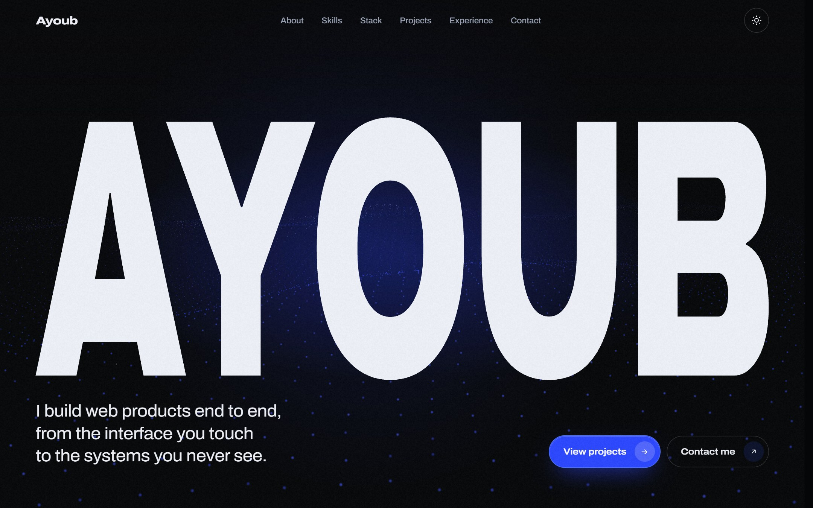

## Sections

### Hero
The name fills the screen over a live field of points that react to the cursor. Scrolling flies the camera into the counter of the **O**, and the next section rises up inside it.

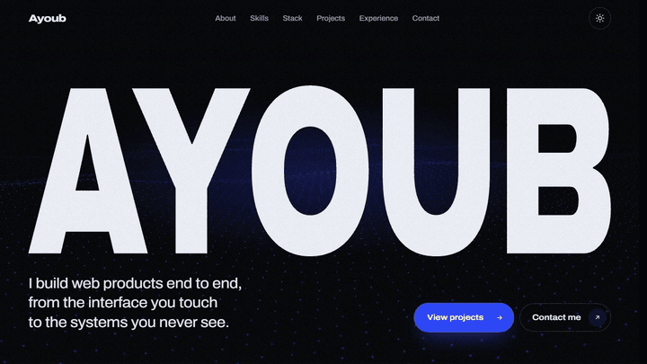

### About
A statement that lights up word by word as you scroll, a short bio, and three working principles.

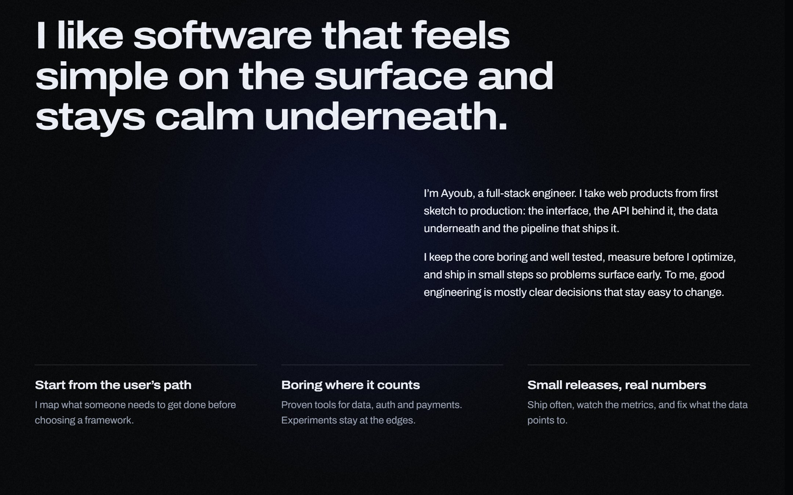

### Skills: one click through four layers
The section pins and tells a story: a click on the top layer sends a pulse of light down through each layer of the stack, one chapter per layer, then back up to an overview with every layer labelled. The layers are brushed-metal slabs rendered with three.js.

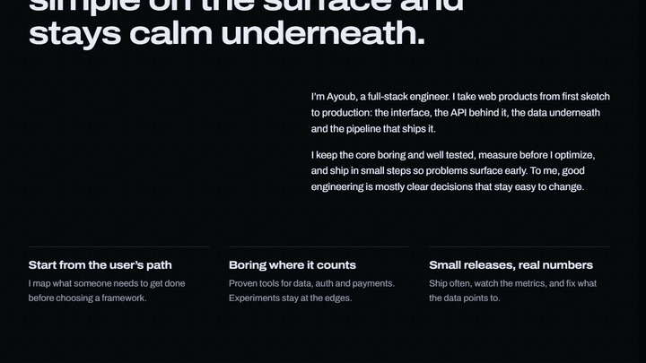

| Frontend | Backend |
| --- | --- |
| 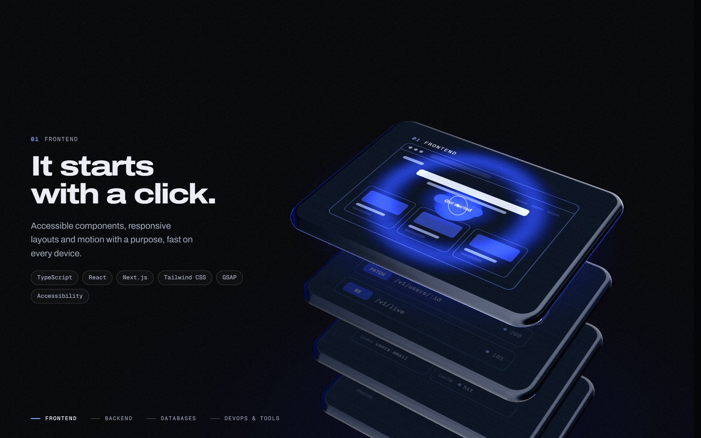 | 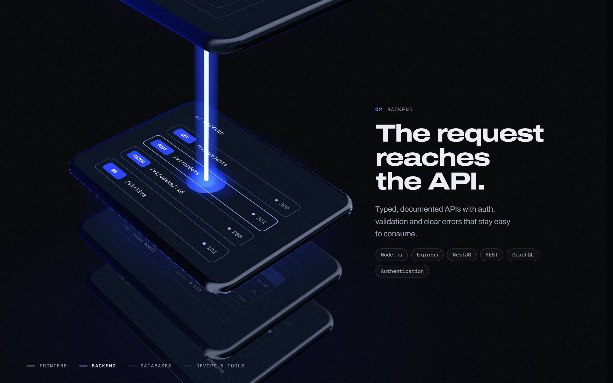 |
| **Databases** | **DevOps & Tools** |
| 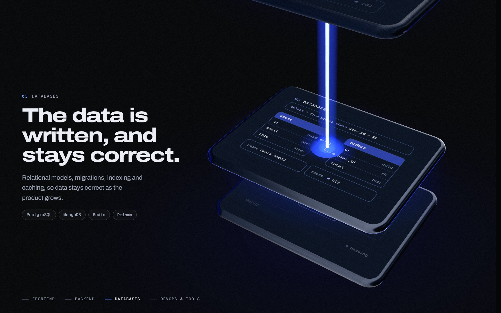 | 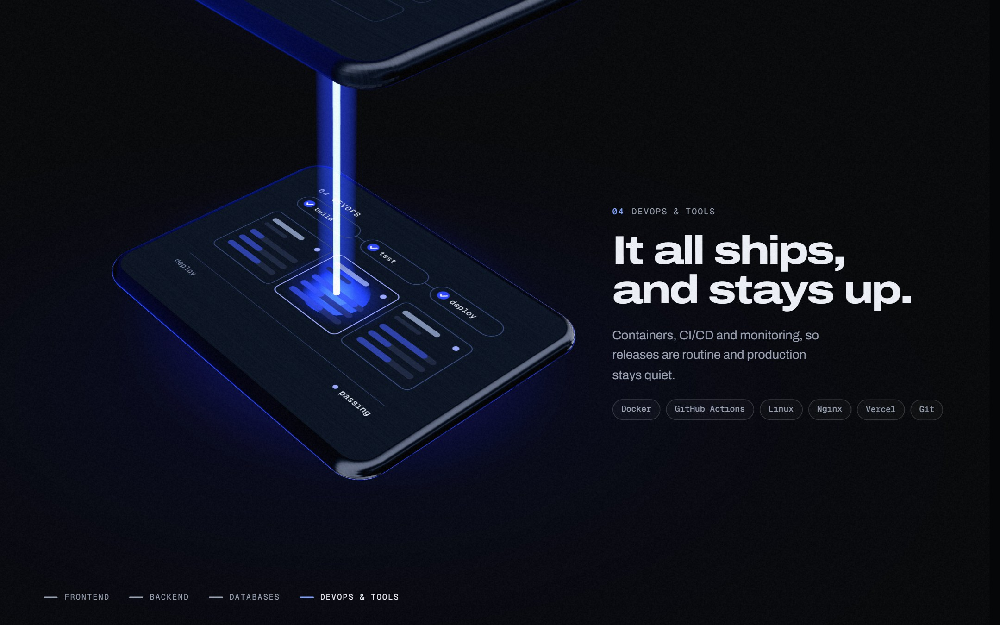 |

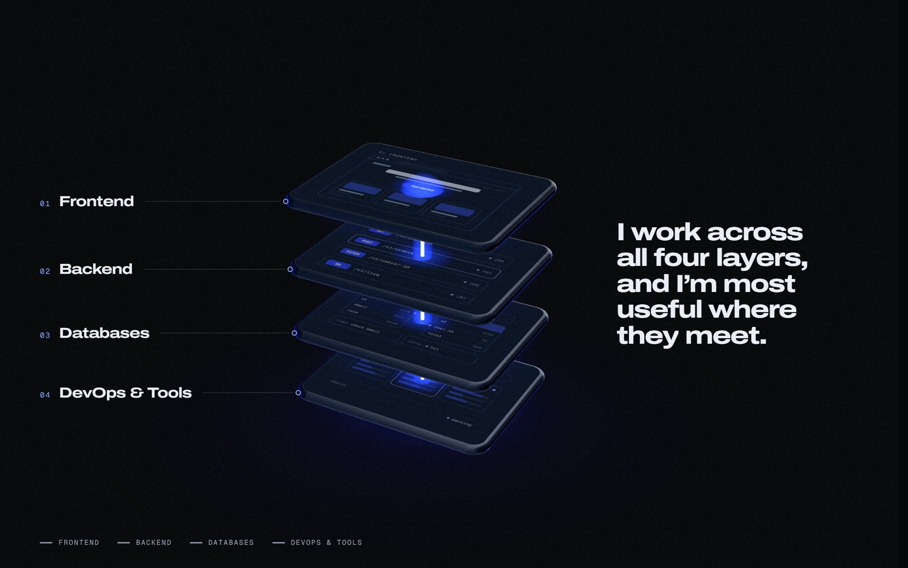

### The Stack
A 3D keyboard (raw WebGL2) of the tools I use. The board flies in and lands as you scroll. Hover a key to press it and read about the tool; click, Enter or Space sends a ripple across the board. On touch screens, tap a key instead.

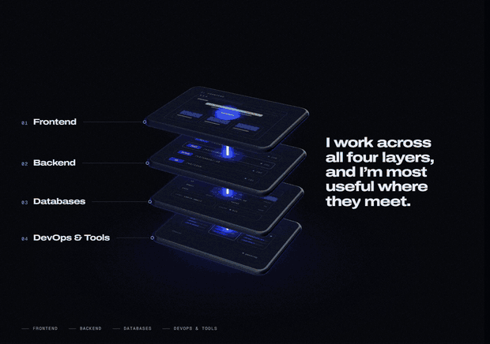

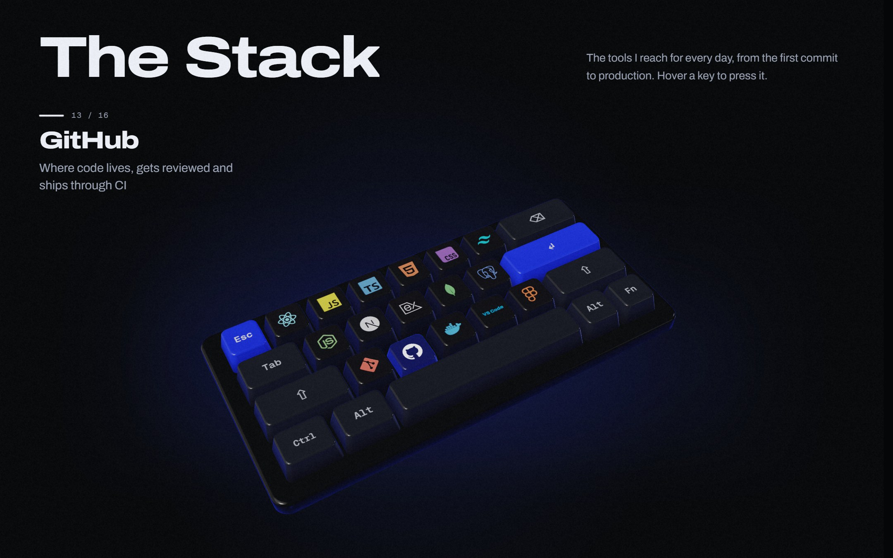

### Projects
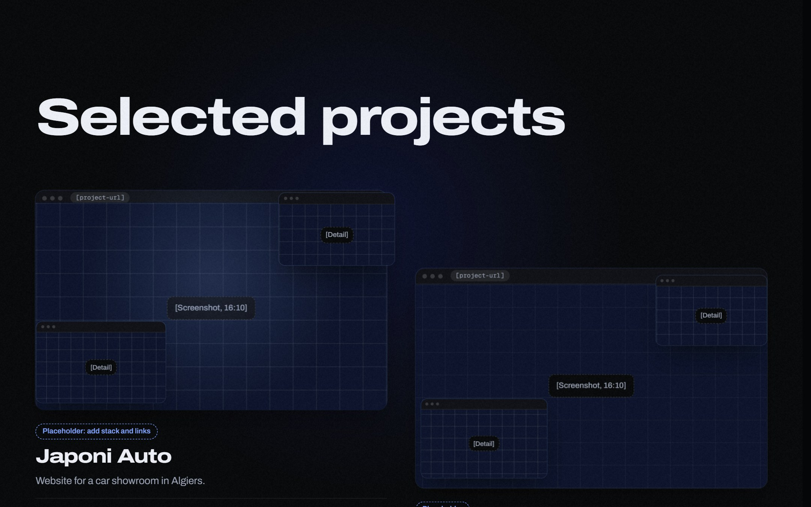

### FAQ
Six questions for clients and hiring teams, next to a title that stays in view as you scroll. Move the mouse over a question and a pale band slides in from the edge you came in by, carrying a strip of keywords and icons that scrolls to the left; it leaves through the edge you go out by. Click a question to open its answer in place.

### Contact
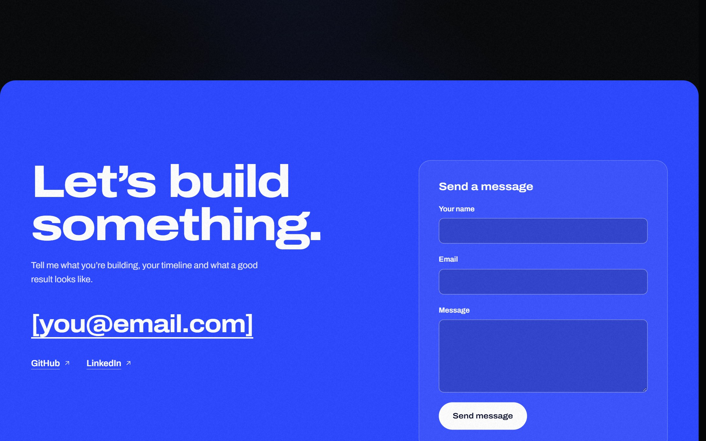

### Footer
Site links, a live local clock and a halftone wordmark.

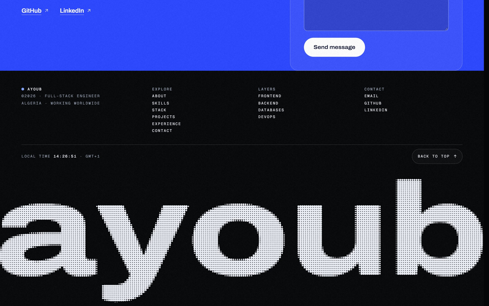

## Details

- Dark and light themes, switched from the nav.
- Smooth scrolling with Lenis, and a speed limit through the hero so the zoom always plays at a steady pace.
- Phones and touch screens: the hero zoom covers the full screen, and the keyboard and layers respond to taps instead of hover.
- `prefers-reduced-motion` is respected: the site switches to a calmer layout with the heavy scroll animation turned down.
- Without WebGL, the keyboard falls back to a plain list of tools.

## Tech

React 18 · Vite · GSAP + ScrollTrigger · Lenis · three.js · WebGL2 · simple-icons

## Run it

```bash
npm install
npm run dev
```

Then open the address Vite prints (usually http://localhost:5173). To see it on a phone on the same Wi-Fi, run `npm run dev -- --host` and open `http://<your-PC-address>:5173` on the phone.

```bash
npm run build     # production build in dist/
npm run preview   # serve the build locally
```

## Make it yours

| What | Where |
| --- | --- |
| Accent colour, default theme, loader, footer clock time zone | [src/config.js](src/config.js) |
| Links, skills and layers, projects, FAQ questions and answers, the tool keys | [src/content.js](src/content.js) |
| FAQ hover icons (Solar by 480 Design, CC BY 4.0) | [src/lib/faqIcons.js](src/lib/faqIcons.js) |
| Contact form endpoint (`FORM_ENDPOINT`, empty for now) | [src/content.js](src/content.js) |
| Page sections | [src/components](src/components) |
| Scroll animation, the hero zoom and the pinned stories | [src/lib/motion.js](src/lib/motion.js) |
| 3D keyboard and 3D layers | [src/lib/keyboard.js](src/lib/keyboard.js), [src/lib/layers.js](src/lib/layers.js) |
| Styles | [src/styles/portfolio.css](src/styles/portfolio.css) |

Some text in Projects, FAQ and Contact is still placeholder content (shown in square brackets in the screenshots above) and is meant to be replaced in `src/content.js`.
